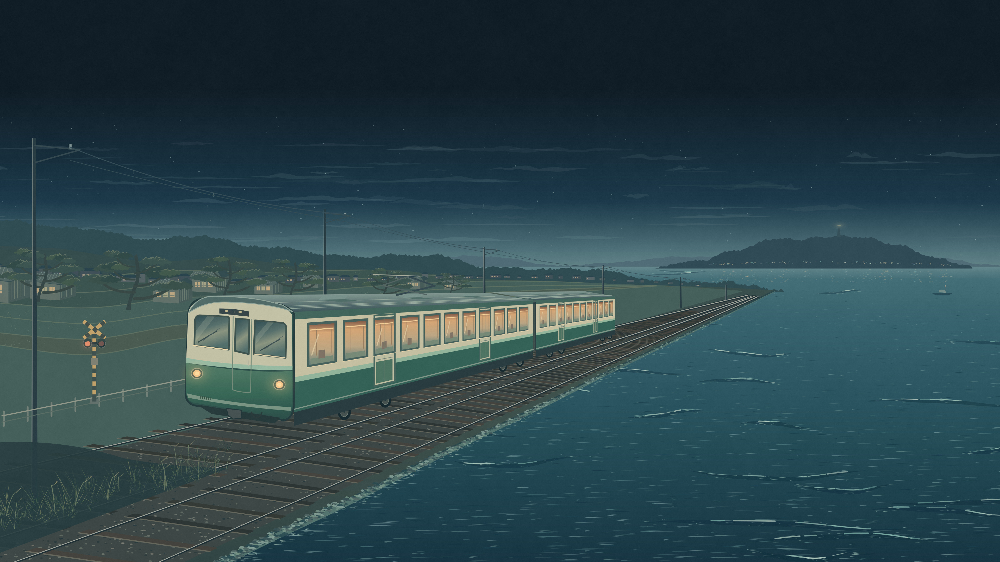

# Japan Night — Kamakura Shiosai

Sea-glass jade and midnight blue along the Japanese coast. A dark companion theme for [Omarchy](https://omarchy.org/), part of the [Japan Night](https://github.com/devgtv/omarchy-japan-night-theme) collection.

[](backgrounds/kamakura-shiosai.jpg)

## Install

```bash
omarchy theme install https://github.com/devgtv/omarchy-japan-night-kamakura-shiosai-theme.git
```

Omarchy installs and applies the theme. To switch back to it later:

```bash
omarchy theme set japan-night-kamakura-shiosai
```

## Wallpaper and bar

A jade-green Enoden train follows the coast toward Enoshima under the night sky. The original illustration is 3840 × 2160; its upper eighth is quiet, dark sky so a top bar does not obscure the main scene. `colors.toml` supplies the Omarchy palette and `waybar.css` defines matching foreground and background colours for Waybar setups.

The [editable SVG master](artwork/kamakura-shiosai.svgz) can be rendered at other resolutions. For example, with librsvg:

```bash
gzip -dc artwork/kamakura-shiosai.svgz | rsvg-convert -w 5120 -h 2880 > kamakura-shiosai.png
```

## More themes

See the [Japan Night collection](https://github.com/devgtv/omarchy-japan-night-theme#night-journeys) for the other Night Journeys variants.
